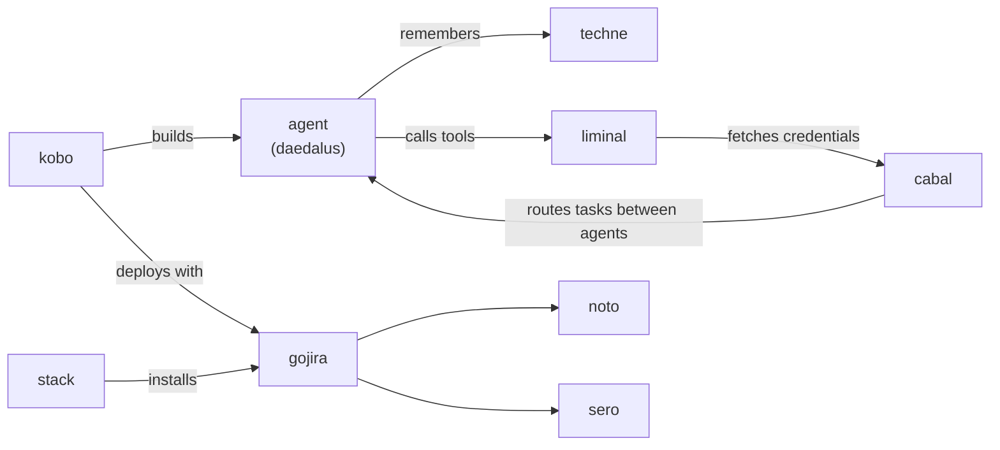

<a href="https://tenish.ai">
  <picture>
    <source media="(prefers-color-scheme: dark)" srcset="banner-dark.svg">
    
  </picture>
</a>

Run teams of AI agents on your own machines: memory that lasts across sessions, a gateway and broker that hand each agent only the credentials it needs, and a platform to deploy, watch and secure them. Mostly Python, MIT-licensed, and each piece runs on its own.

**[tenish.ai](https://tenish.ai)** · security reports to security@tenish.ai

### Agents

- **[techne](https://github.com/tenishai/techne)**: memory for agents in one local SQLite file. Hybrid keyword and vector recall, and self-maintenance that proposes knowledge for you to review rather than writing it unasked.
- **[cabal](https://github.com/tenishai/cabal)**: control plane and A2A broker. Every hop between agents gets a short-lived token narrowed to that hop.
- **[liminal](https://github.com/tenishai/liminal)**: MCP gateway. One connection per agent, many tool handlers behind it, credentials fetched per call.
- **[daedalus](https://github.com/tenishai/daedalus)**: agent construction kit. An agent is a directory; tool approval fails closed.

### Platform

- **[stack](https://github.com/tenishai/stack)**: one YAML file and `stack install` bring the suite up on a cluster, in dependency order, and it is safe to re-run.
- **[kobo](https://github.com/tenishai/kobo)**: compose an agent from catalogs and deploy it to your cluster, then teach it and decide who may reach it.
- **[bab](https://github.com/tenishai/bab)**: one allow, approve or deny check per tool call, on OpenFGA.
- **[gojira](https://github.com/tenishai/gojira)**: opinionated GKE deploy platform; drift and rightsizing come back as pull requests.
- **[noto](https://github.com/tenishai/noto)**: observability on OpenTelemetry, Mimir, Loki, Tempo and Perses.
- **[sero](https://github.com/tenishai/sero)**: runs OpenBao and syncs its secrets to where workloads read them.
- **[litellm-deploy](https://github.com/tenishai/litellm-deploy)**: the model gateway deployment the stack installs.
